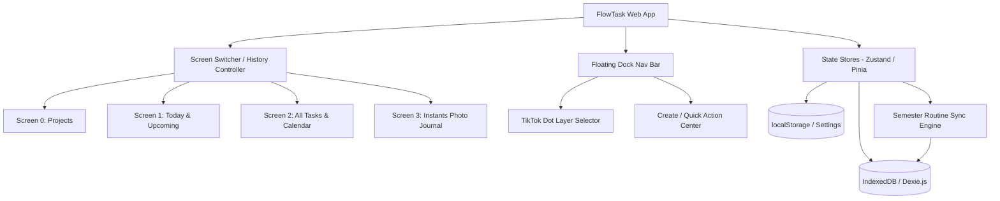
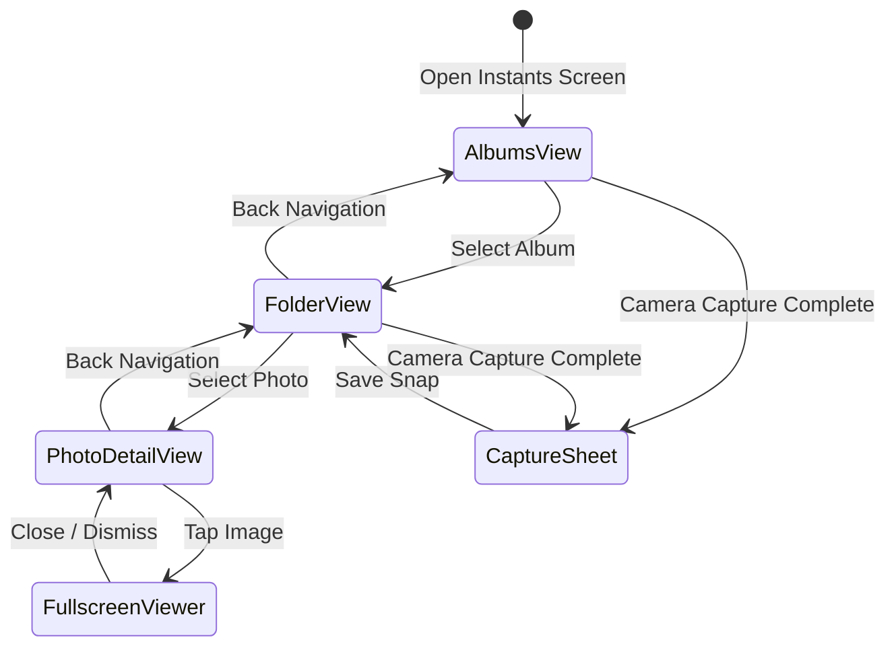
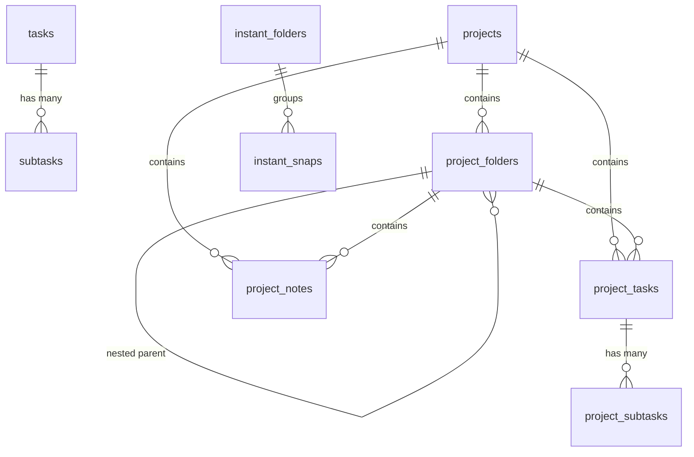

# FlowTask — Full Web Migration Specification & Architecture Guide

> **Document Version:** 1.0.0  
> **Target Platform:** Modern Web (PWA / Desktop & Mobile Browsers)  
> **Source Platform:** Android 14/15 (Jetpack Compose, Room SQLite v5, Material 3 Expressive)  
> **Author:** Antigravity AI Engineering & Architecture Team  
> **Project Scope:** Complete blueprint for rebuilding FlowTask for the web without referencing Android source code.

---

## Table of Contents

1. [Executive Summary & Web Architecture Overview](#1-executive-summary--web-architecture-overview)
2. [Screen & Navigation Specifications](#2-screen--navigation-specifications)
   - [2.1 Application Shell & Navigation Pager](#21-application-shell--navigation-pager)
   - [2.2 Floating Dock Navigation Bar](#22-floating-dock-navigation-bar)
   - [2.3 Screen 0: Projects Screen (`ProjectsScreen.kt`)](#23-screen-0-projects-screen)
   - [2.4 Screen 1: Today & Upcoming Screen (`TodayUpcomingScreen.kt`)](#24-screen-1-today--upcoming-screen)
   - [2.5 Screen 2: All Tasks & Smart Calendar (`AllTasksCalendarScreen.kt`)](#25-screen-2-all-tasks--smart-calendar)
   - [2.6 Screen 3: Instants Micro-Journaling (`InstantsScreen.kt`)](#26-screen-3-instants-micro-journaling)
   - [2.7 Global Modals, Drawers & Bottom Sheets](#27-global-modals-drawers--bottom-sheets)
3. [ViewModels, UI State & Business Logic Engine](#3-viewmodels-ui-state--business-logic-engine)
   - [3.1 Task Management Engine (`TaskViewModel.kt`)](#31-task-management-engine)
   - [3.2 Project & Note Hierarchy Engine (`ProjectViewModel.kt`)](#32-project--note-hierarchy-engine)
   - [3.3 Instants & Photo Capture Engine (`InstantViewModel.kt`)](#33-instants--photo-capture-engine)
   - [3.4 User Settings & Preferences Engine (`SettingsViewModel.kt`)](#34-user-settings--preferences-engine)
   - [3.5 Academic Semester & Multi-Program Routine Sync Engine](#35-academic-semester--multi-program-routine-sync-engine)
   - [3.6 Rich Markdown Note Parser & Editor Engine (`NoteRichFormat.kt`)](#36-rich-markdown-note-parser--editor-engine)
4. [Material 3 Expressive Design Tokens & Styling Guide](#4-material-3-expressive-design-tokens--styling-guide)
   - [4.1 Color Palettes (Light, Dark, and AMOLED Dark)](#41-color-palettes)
   - [4.2 Preset Accent Colors](#42-preset-accent-colors)
   - [4.3 Mathematical HSL Dock Harmonization System](#43-mathematical-hsl-dock-harmonization-system)
   - [4.4 Material 3 Project Tonal Harmonizer](#44-material-3-project-tonal-harmonizer)
   - [4.5 Typography Scale](#45-typography-scale)
   - [4.6 Shapes & Corner Radii](#46-shapes--corner-radii)
   - [4.7 Spring Motion Physics & Tactile Interactions](#47-spring-motion-physics--tactile-interactions)
5. [Data Layer, Schemas & Storage Migration](#5-data-layer-schemas--storage-migration)
   - [5.1 Relational Database Schema (Room SQLite v5 -> IndexedDB / Dexie.js)](#51-relational-database-schema)
   - [5.2 Key-Value Preferences Schema (SharedPreferences -> `localStorage`)](#52-key-value-preferences-schema)
   - [5.3 Android Libraries to Web Equivalents Mapping](#53-android-libraries-to-web-equivalents-mapping)
6. [Web Implementation Blueprint & Technology Stack](#6-web-implementation-blueprint--technology-stack)
   - [6.1 Recommended Web Stack](#61-recommended-web-stack)
   - [6.2 File Structure Proposal](#62-file-structure-proposal)
   - [6.3 Dexie.js Database Implementation Sample](#63-dexiejs-database-implementation-sample)
   - [6.4 Tailwind CSS v4 Configuration & CSS Variables](#64-tailwind-css-v4-configuration--css-variables)

---

## 1. Executive Summary & Web Architecture Overview

FlowTask is an expressive, fluid personal organization system combining:
1. **Hierarchical Project Management:** Multi-level folders, tasks with subtasks, and rich-text markdown notes with block formatting.
2. **Coordinated Viewport Task Management:** Today and Upcoming tasks displayed within a spring-animated non-overlapping dual container.
3. **Smart Continuous Calendar:** Longitudinal monthly timeline with task activity markers, multi-day period shading, and academic/routine schedules.
4. **Instants Micro-Journaling:** Quick camera captures cropped to 4:3 aspect ratio, organized into Google Photos-style album covers with attached notes.
5. **Academic & Weekly Program Engine:** Recurring weekly timetables with week numbering and selective SQLite synchronization.
6. **Expressive Material 3 Design:** Custom HSL tonal harmonization, spring physics, dynamic AMOLED support, and tactile press scaling.

### Architectural Migration Target
The web version must be a **Single Page Application (SPA)** or **Progressive Web App (PWA)** that operates **100% offline-first**. All data is stored locally in the browser via **IndexedDB** and **`localStorage`**, with optional cloud sync capability.



---

## 2. Screen & Navigation Specifications

### 2.1 Application Shell & Navigation Pager

The app shell coordinates a full-viewport experience with an edge-to-edge layout, responsive container, top application bar, screen carousel/router, and a persistent floating capsule dock.

#### Component Hierarchy
```
Scaffold (Background: BgLight)
├── TopAppBar (Status Bar Padding, Horizontal: 22dp, Vertical: 14dp)
│   ├── AppTitle ("FlowTask", 24sp, Black 900, AccentPrimary, Tracking: -0.5sp)
│   └── SettingsButton (42dp circle, SurfaceLight bg, Settings icon 22dp) -> Opens SettingsBottomSheet
├── Viewport / HorizontalScreenPager (Full Size, swipeable or route-switched)
│   ├── Screen 0: ProjectsScreen
│   ├── Screen 1: TodayUpcomingScreen (Default initial page)
│   ├── Screen 2: AllTasksCalendarScreen
│   └── Screen 3: InstantsScreen
├── FloatingDockNavBar (Positioned Bottom Center, bottom margin: 24dp or 6dp in search)
└── Modal Layer (Portals for Bottom Sheets, Dialogs, Fullscreen Viewers)
```

#### Screen Order Configuration
The default screen order is `[0, 1, 2, 3]`:
- `0`: Projects
- `1`: Today & Upcoming
- `2`: All Tasks & Calendar
- `3`: Instants

Users can rearrange this order inside Settings. The active screen order is persisted in preferences (`key_screen_order`). In web navigation, this translates to tab routes (`/projects`, `/today`, `/calendar`, `/instants`) or a swipeable carousel where tab indices reflect the configured order.

---

### 2.2 Floating Dock Navigation Bar

The `FloatingDockNavBar` is a floating capsule dock centered at the bottom of the viewport. It adapts dynamically based on the active screen and search state.

#### Visual Geometry & Color Tokens
- **Outer Bar:** Width: `176dp`, Height: `60dp`, Corner Radius: `30dp` (pill).
- **Background Color:** Calculated dynamically via `calculateDockColors(effectiveAccent, isDark)`.
- **Border:** In dark mode: `1dp solid rgba(255, 255, 255, 0.12)`; in light mode: `none`.
- **Elevation / Shadow:** Soft ambient drop shadow `0 8px 24px rgba(0, 0, 0, 0.15)`.

#### Structure & Actions
```
+-------------------------------------------------------------+
|  [Left: Today Button]   [Center: Primary Action]   [Right: Screen Hub]  |
+-------------------------------------------------------------+
```

1. **Left Button (38dp Circle):**
   - Icon: `Icons.Default.Today` (or `CheckCircle` checkmark).
   - Behavior: If current screen is Calendar in `SMART_CALENDAR` mode, triggers `triggerScrollToTodayCalendar()`. Otherwise, animates navigation to Screen 1 (Today).
2. **Center Button (46dp x 46dp Capsule):**
   - Background Color: `dockColors.centerButtonBackground` (a deeper, contrasting shade of the accent hue).
   - Icon: `+` (`Icons.Default.Add`, 26dp, White).
   - Behavior based on active screen:
     - Screen 0 (Projects): Opens `NewProjectBottomSheet` / Create Project.
     - Screen 1 (Today): Opens `EditTaskBottomSheet` prefilled with today's date (`dueDateMillis = startOfDay`).
     - Screen 2 (Calendar): Opens `EditTaskBottomSheet` without date prefill (`dueDateMillis = null`).
     - Screen 3 (Instants): Opens `NewInstantFolderDialog` (Create Photo Album).
3. **Right Button (38dp Circle):**
   - Icon: Screen icon or `Icons.Default.GridView` / `Folder` / `Schedule` / `CalendarMonth` / `PhotoLibrary`.
   - Behavior:
     - **Tap:** Opens the expandable radial/card screen navigation menu overlay.
     - **Horizontal Swipe Gesture:** Dragging horizontally by >30dp switches to the adjacent screen in the configured order.

#### Above-Dock Accessory Elements
Depending on the active screen, an accessory control floats directly above the dock:
- **Projects Screen (0):** Floating search capsule ("Търсене в проекти..." / "Search in projects..."). Tapping activates search mode.
- **Today (1) & Calendar (2) Screens:** `TikTokDotLayerSelector` — a swipeable horizontal dot carousel displaying available task layers ("Всички" / "All", plus custom layers) with active tooltip badge and haptic clicks.
- **Instants Screen (3):** Quick Camera Capture pill ("Снимай" / "Snap" with `Icons.Default.PhotoCamera`).

#### Search Mode State (Projects)
When search is active:
- The dock expands horizontally to `fillMaxWidth(padding: 16dp)` and docks lower (`bottom: 6dp`).
- Contains a search icon, clean text input (`BasicTextField`), clear button (`Icons.Default.Close`), and back button.
- Swiping down by >36px dismisses search and restores normal dock capsule.

---

### 2.3 Screen 0: Projects Screen (`ProjectsScreen.kt`)

The Projects screen provides an enterprise-grade hierarchical file system for organization, encompassing projects, nested folders, tasks with subtasks, and rich-text notes.

#### Visual Hierarchy
```mermaid
graph TD
    ProjectsScreen --> Dashboard[Projects Dashboard View]
    ProjectsScreen --> Detail[Project Detail View]
    
    Dashboard --> SearchResults[Search Results List]
    Dashboard --> PinnedProjects[Pinned Projects Section]
    Dashboard --> AllProjects[All Projects Grid / List]
    
    Detail --> Header[Project Header & Folder Breadcrumbs]
    Detail --> FilterTabs[Filter Chips: ALL | FOLDERS | TASKS | NOTES]
    Detail --> SubfoldersSection[Subfolders Grid / Cards]
    Detail --> TasksSection[Project Tasks with Subtasks]
    Detail --> NotesSection[Project Notes Cards & Rich Preview]
```

#### 1. Projects Dashboard View
- **Header:** Title ("Проекти" / "Projects"), total count badge, search button.
- **Search Active State:** Filters across all projects and folder paths in real-time. Matches are grouped by project with highlighted breadcrumb paths (`Project > Subfolder > Target`). Tapping a match jumps directly to that hierarchy.
- **Pinned Projects Section:** Horizontal or vertical cards for projects marked `isPinned = true`. Pinned projects display a pin badge (`Icons.Default.PushPin`).
- **All Projects Section:** Grid (2 columns on tablet/desktop, 1-2 on mobile) of project cards.
  - Card components:
    - Custom icon container (44dp rounded squircle, project color background).
    - Project name (`titleMedium`, bold).
    - Project description (`bodySmall`, muted).
    - Item counters: `X папки` (folders), `Y задачи` (tasks), `Z бележки` (notes).
  - Gestures & Interactions:
    - **Tap:** Opens `ProjectDetailView` for that project.
    - **Long-Press:** Opens `ProjectActionPopup` modal with actions:
      1. Pin / Unpin project (`isPinned = !isPinned`).
      2. View Project Details (opens `ProjectDetailsBottomSheet` with statistics).
      3. Edit Project (opens edit modal to change name, description, color, icon).
      4. Delete Project (with cascading deletion confirmation).
    - **Drag & Drop Reorder:** Long-pressing and dragging reorders project items, updating `sortOrder` in database.

#### 2. Project Detail View
- **Navigation Header:**
  - Back arrow (navigates up one folder level; if at root, returns to Dashboard).
  - Project icon & Title.
  - Breadcrumbs Bar: Scrollable horizontal breadcrumb path (`Project > Root Folder > Child Folder`). Tapping any breadcrumb navigates back to that exact depth.
  - Three-dot overflow menu:
    - "Нова папка" (Add folder).
    - "Нова задача" (Add task).
    - "Нова бележка" (Add note).
    - "Преименувай папка" (Rename current folder, if inside folder).
    - "Изтрий папка" (Delete current folder, if inside folder).
- **Filter Chips Bar:** Single-choice segmented chips:
  - `ALL` (Shows folders, tasks, and notes).
  - `FOLDERS` (Filters view to show only subfolders).
  - `TASKS` (Filters view to show only tasks).
  - `NOTES` (Filters view to show only rich notes).
- **Subfolders Section:**
  - Displays folder cards with folder icon, custom color, folder name, and total item count badge.
  - Tap opens the folder (pushes to `folderNavigationStack`).
  - Dropdown options: Rename folder, Move folder, Delete folder.
- **Tasks Section:**
  - Shows `ProjectTaskItem` cards.
  - Task completion checkbox (circular checkbox). Checked tasks receive strikethrough.
  - Expandable subtasks: Chevron toggles display of child subtasks with individual checkboxes and inline "Добави подзадача" input.
  - Actions: Edit task, Move task to another folder, Delete task.
- **Notes Section:**
  - Shows `ProjectNoteCard` cards with title, content preview (renders first few lines of parsed markdown), and checklist completion progress.
  - Tap opens the `ProjectNoteEditor`.
  - Reorder support: Notes maintain independent `sortOrder` per folder level.

#### 3. Project Rich Note Editor (`ProjectNoteEditor.kt`)
The Note Editor operates in two display modes:
1. **Modal Bottom Card Mode:** Floats over the screen with a swipe handle, title, action bar, and editable content.
2. **Fullscreen Mode:** Expands to full screen with comprehensive formatting toolbar at the bottom.

**Block-Based Rich Content System:**
Notes are stored internally as standard Markdown text, but edited via a structured block parser (`NoteRichParser`):
- `PARAGRAPH`: Standard paragraph text.
- `HEADING_1`: `# Heading 1` (24sp, bold).
- `HEADING_2`: `## Heading 2` (20sp, bold).
- `HEADING_3`: `### Heading 3` (17sp, bold).
- `CHECKLIST`: `- [ ] item` or `- [x] item` (interactive checkbox + editable label).
- `BULLET`: `- item` or `• item` (bullet point).
- `NUMBERED`: `1. item` (auto-incrementing numbered list).
- `QUOTE`: `> quote text` (accent border on left, italic).
- `DIVIDER`: `---` (horizontal line).
- `CODE_BLOCK`: ```` ``` ```` (monospaced syntax container with dark background).

**Editor Toolbar Actions:**
`Bold` (`**`), `Italic` (`*`), `Strikethrough` (`~~`), `Inline Code` (`` ` ``), `H1`, `H2`, `H3`, `Checklist`, `Bullet List`, `Numbered List`, `Quote`, `Divider`, `Code Block`, `Undo` (full stack), `Redo` (full stack), `Save & Close`.

---

### 2.4 Screen 1: Today & Upcoming Screen (`TodayUpcomingScreen.kt`)

A dual-container screen managing current and near-future tasks using coordinated spring physics.

```mermaid
graph TD
    TodayUpcomingScreen --> LayerFilterBar[Profile / Layer Filter Bar]
    TodayUpcomingScreen --> DualContainer[Coordinated Dual-Container Viewport]
    DualContainer --> TodayContainer[Top Container: Today Tasks]
    DualContainer --> UpcomingContainer[Bottom Container: Upcoming Tasks (10 Days)]
```

#### Dual-Container Coordinated Viewport Physics
Instead of a standard scroll view, Today and Upcoming live inside two coordinated vertical containers separated by a `10dp` gap (`SpringSheetPhysics`):
- **Resting State:**
  - Top Container (Today): Takes remaining height from top down to the Upcoming drawer.
  - Bottom Container (Upcoming): Rests at `295dp` height (or `180dp` if no upcoming tasks).
- **Expanded Upcoming State:**
  - Dragging or flinging the Upcoming header upwards expands it to take `100% - 64dp` of the viewport.
  - Top Container (Today) smoothly compresses to a docked header strip of `64dp` displaying the remaining task count.
- **Physics Engine Tokens:**
  - `FLICK_VELOCITY_THRESHOLD = 400f` (pixels/sec).
  - `EXPAND_PROGRESS_THRESHOLD = 0.5f` (50% drag threshold snaps to full expansion).
  - Spring animation: `dampingRatio = 0.8f, stiffness = 380f`.
  - Scrim overlay over Today container: alpha scales `0.0f` to `0.25f` proportional to expansion.

#### Task Card Specification (`TaskCard.kt`)
Each task is rendered with:
- **Card Container:** Rounded corner radius `18dp` (`medium`), background `SurfaceLight` (or `SurfaceContainerLight` in dark mode), subtle border `OutlineSubtle`.
- **Completion Checkbox:** 24dp round checkbox. Checked state displays accent fill with white checkmark; unchecked displays subtle outline (`#CBD5E1` in light, `#6B7488` in dark).
- **Title / Explanation:** `titleSmall` (15sp, bold text). When completed: text opacity 0.5 and strikethrough.
- **Schedule Time Badge:** If `dueTimeMinutes` is present, renders a pill badge:
  - If task is ongoing/current: accent colored badge.
  - Standard: muted container with clock icon (`14:30`).
- **Date Period Badge:** If task spans a date range (`startDateMillis` to `dueDateMillis`), displays calendar icon with formatted range (e.g., `12 май – 18 май`).
- **Layer Badge:** If `layer` is set, displays small rounded pill with layer name.
- **Subtasks Preview:** Shows `completed / total` counter (e.g., `✓ 2/4`). Tapping card expands subtask checklist items inline.
- **Tactile Interaction:** Compresses by 3% (`scale: 0.97`) on active pointer press and springs back on release (`expressiveBounce`).
- **Reordering:** In Today's list, non-timed tasks can be moved up or down via swipe or reorder buttons.

#### Completed Tasks Section
- Completed tasks are grouped under an expandable header ("Завършени (N)" / "Completed (N)") with chevron icon.
- Toggling collapses or expands completed tasks without cluttering active items.

---

### 2.5 Screen 2: All Tasks & Smart Calendar (`AllTasksCalendarScreen.kt`)

Offers two interchangeable viewing paradigms: an aggregate searchable list and an interactive continuous monthly calendar.

#### View Mode Switcher
Segmented control in top bar:
- `LIST`: Flat, searchable list of all tasks grouped into **Active** and **Completed**.
- `SMART_CALENDAR`: Continuous scrolling monthly calendar grid.

#### Collapsible Filter Container (`CollapsibleFiltersContainer.kt`)
Tapping the filter/tune button expands a filter panel containing:
1. **Layer Filter Bar:** Chips for all defined task layers plus "All".
2. **Program Routine Filter Bar:** Pills for recurring programs (e.g., "Университет", "Фитнес", "Работа") with program-specific color dots and count badges.

#### Smart Calendar Specification
- **Scroll Mechanism:** Continuous vertical virtualized list of months spanning from `-12 months` to `+24 months` relative to current date.
- **Month Header:** Centered month name and year (e.g., `Май 2026`), font weight Bold 20sp.
- **Days of Week Header:** 7 columns starting on **Monday** (`Пн`, `Вт`, `Ср`, `Чт`, `Пт`, `Сб`, `Нд` in BG; `Mon` - `Sun` in EN).
- **Day Cell Rendering:**
  - Square aspect ratio cell.
  - Day number (1-31).
  - **Today Marker:** Highlighted with ring outline or accent pill, bold text.
  - **Selected Date Marker:** Solid accent circle background with white text.
  - **Task Activity Indicators:** Dots beneath the day number representing pending tasks.
  - **Program Routine Indicators:** Tiny colored rounded bars/dots representing classes/habits scheduled for that weekday.
  - **Period Range Shading:** For tasks with `startDateMillis` and `dueDateMillis`, contiguous days display connected horizontal background highlight strips with rounded caps on start and end dates.
- **Date Tap Interaction:**
  - Opens `CalendarDateTasksBottomSheet` displaying:
    1. Full date title (e.g., `Понеделник, 15 Май 2026`).
    2. Scheduled Routine Items for that weekday (subject, start/end time, room/note).
    3. Specific tasks due on that date (with completion checkboxes, times, subtasks).
    4. "Добави задача за тази дата" (Add task for this date) button.

---

### 2.6 Screen 3: Instants Micro-Journaling (`InstantsScreen.kt`)

A dedicated visual micro-journal designed for rapid photo capture, 4:3 image framing, and album-based sorting.



#### 1. Albums View (`InstantScreenView.Albums`)
- **Grid Layout:** 2-column responsive grid of album cards.
- **Album Card:**
  - 4:3 aspect ratio card with rounded corners (`18dp`).
  - Cover photo: Displays `latestPhotoPath` of the newest photo in that folder. If empty, displays placeholder icon with gradient background.
  - Folder Name: Bold title at bottom.
  - Count Badge: Pill badge displaying total photos count (`X снимки`).
  - Three-dot menu: Delete custom album (reassigns all existing snaps to "Unsorted").
- **"Нов албум" Card:** Dashed/outlined card with `Icons.Default.CreateNewFolder` to create a new folder.

#### 2. Folder View (`InstantScreenView.Folder`)
- **Header:** Back arrow, Folder title, total photo count.
- **Grid:** 3-column (mobile) or 4-6 column (desktop) grid of 4:3 photos.
- **Tap Photo:** Navigates to `PhotoDetailView`.

#### 3. Photo Detail View (`InstantScreenView.PhotoDetail`)
- **Image Canvas:** 4:3 aspect ratio high-res image with zoom trigger.
- **Note Input / Display:** Text card below photo showing attached explanation note. Can be edited inline.
- **Metadata:** Formatted creation timestamp (e.g., `18 май 2026 в 16:45`).
- **Action Buttons:**
  - Move to another album (`Icons.AutoMirrored.Filled.DriveFileMove`).
  - Edit note.
  - Delete photo (removes image from disk and database).

#### 4. Instant Capture Bottom Sheet (`InstantCaptureBottomSheet.kt`)
Triggered immediately after capturing a photo:
1. Displays 4:3 preview of the taken shot.
2. Note input field ("Добави бележка към снимката..." / "Add a note to this photo...").
3. Folder selection carousel: Horizontal row of Google Photos-style album cards with one-tap selection. Default is "Unsorted" or currently opened folder.
4. Save button ("Запази" / "Save") & Discard button (deletes temporary photo file if cancelled).

#### 5. Fullscreen Image Viewer (`FullScreenImageViewer.kt`)
- Black backdrop modal.
- Pan & pinch-to-zoom support (1x to 4x scale).
- Double-tap to toggle between 1x and 2.5x zoom.
- Close button at top right.

---

### 2.7 Global Modals, Drawers & Bottom Sheets

#### 1. Edit / Add Task Bottom Sheet (`EditTaskBottomSheet.kt`)
- **Fields:**
  - Task explanation input (autofocused, multiline, clear button).
  - Single-day or Period Date toggle:
    - Single day: Pick `dueDateMillis`.
    - Period: Pick `startDateMillis` and `dueDateMillis` via date picker modal.
  - Due Time: Optional time picker (hours & minutes).
  - Layer Picker: Horizontal chips with "+ Нов профил" (New layer), selected state, and long-press to edit/rename layer.
  - Subtasks Checklist: List of added subtask text items with drag-to-reorder, delete button, and "+ Добави подзадача" input.
- **Actions:** "Запази" (Save) and "Отказ" (Cancel).

#### 2. Settings Bottom Sheet (`SettingsBottomSheet.kt`)
- **Language Selector:** Bulgarian (`bg`) or English (`en`).
- **Theme Mode Segmented Button:** Light (`light`), Dark (`dark`), or System (`system`).
- **AMOLED Dark Mode Switch:** Pure black background (`#000000`) for OLED displays.
- **Accent Color Palette Picker:** Row of circles for preset colors (Sage Teal, Indigo Focus, Ocean Blue, Coral Rose, Sunset Amber, Modern Purple, Slate Minimal) plus dynamic accent option.
- **Dynamic Color Style (if dynamic selected):** Balanced, Vibrant, Muted, High Contrast.
- **Screen Order Reorderer:** Interactive list of 4 screens with Up/Down buttons to customize tab order.
- **Academic Programs & Timetable Shortcut:** Opens `SemesterProgramBottomSheet`.
- **Program Tasks Everywhere Switch:** Toggles whether recurring schedule items are synced into SQLite as concrete tasks.

#### 3. Semester & Academic Program Sheet (`SemesterProgramBottomSheet.kt`)
Manages multi-program recurring weekly timetables across 4 internal modes:
- **`HUB`:** List of all programs (folders with weekly schedule summary, active toggle switch, delete button) + "Нова програма" button.
- **`DETAILS`:** Weekly calendar grid view (Monday through Sunday columns) listing `ScheduleItem` routines with times, subjects, locations/rooms, and edit controls.
- **`CREATE`:** Card modal to create a program: layer name, color, optional date range, week numbering toggle, show everywhere toggle.
- **`EDIT`:** Edit program attributes and manage `ScheduleItem` routines.

---

## 3. ViewModels, UI State & Business Logic Engine

FlowTask utilizes reactive state management driven by Kotlin `StateFlow`. In the web architecture, these ViewModels map directly to reactive stores (e.g. **Zustand** in React, **Pinia** in Vue, or **runes** in Svelte 5).

### 3.1 Task Management Engine (`TaskViewModel.kt`)

#### State Variables
| State Variable | Type | Default | Description |
|---|---|---|---|
| `selectedLayer` | `string \| null` | `null` | Active layer filter (`null` = show all layers) |
| `availableLayers` | `string[]` | `[]` | Distinct union of layers from tasks + active programs |
| `todayTasks` | `TaskWithSubTasks[]` | `[]` | Filtered tasks due today or active in today's period |
| `upcomingTasks` | `TaskWithSubTasks[]` | `[]` | Filtered tasks starting/due within next 10 days |
| `allTasks` | `TaskWithSubTasks[]` | `[]` | All tasks filtered by search query & layer |
| `taskDatesWithActivity` | `Set<number>` | `Set()` | Timestamps of dates with active tasks (for calendar dots) |
| `selectedCalendarDate` | `number \| null` | `startOfDay()` | Currently inspected date in calendar |
| `selectedCalendarDateTasks`| `TaskWithSubTasks[]` | `[]` | Tasks occurring on `selectedCalendarDate` |
| `editingTask` | `TaskWithSubTasks \| null` | `null` | Task currently loaded in edit bottom sheet |
| `isAddOrEditSheetVisible` | `boolean` | `false` | Visibility of task edit modal |
| `defaultDateForNewTask` | `number \| null` | `null` | Preselected due date when creating new task |
| `defaultStartDateForNewTask`| `number \| null` | `null` | Preselected start date when creating new task |
| `searchQuery` | `string` | `""` | Search string for all tasks |
| `allTasksViewMode` | `"LIST" \| "SMART_CALENDAR"` | `"LIST"` | Calendar view toggle |
| `calendarFiltersExpanded` | `boolean` | `false` | Whether calendar filter bar is expanded |

#### Business Logic Rules & Methods
1. **`getTodayTasks()` Query Logic:**
   A task qualifies as a "Today" task if:
   - Single-day task: `startDateMillis == null` AND `dueDateMillis >= startOfDay AND dueDateMillis <= endOfDay`.
   - Multi-day period task: `startDateMillis != null` AND `startDateMillis <= endOfDay` AND `dueDateMillis >= startOfDay`.
   - Flexible untimed task: `dueDateMillis == null` AND `isCompleted == false`.
2. **`getUpcomingTasks(days = 10)` Query Logic:**
   - Tasks where effective start date (`startDateMillis ?: dueDateMillis`) is strictly greater than today's `endOfDay` and less than or equal to `endOfDay + (10 * 86400000)`.
3. **Reordering Tasks (`moveTaskUp` / `moveTaskDown`):**
   - Applies only to untimed tasks (`dueTimeMinutes == null`). Swaps consecutive items in memory and updates `sortOrder` integers in database.
4. **Layer Management:**
   - Renaming a layer: updates `tasks.layer` where `TRIM(layer) = oldName`, and cascades the rename to all matching `LayerProgram` objects.
   - Deleting a layer: accepts a boolean parameter `deleteTasks`. If true, runs `DELETE FROM tasks WHERE layer = layerName`; if false, sets `layer = NULL`.

---

### 3.2 Project & Note Hierarchy Engine (`ProjectViewModel.kt`)

#### State Variables
| State Variable | Type | Default | Description |
|---|---|---|---|
| `projects` | `ProjectEntity[]` | `[]` | All projects sorted by `isPinned DESC, sortOrder ASC` |
| `selectedProject` | `ProjectEntity \| null` | `null` | Currently opened project (`null` = on dashboard) |
| `folderNavigationStack` | `ProjectFolderEntity[]` | `[]` | Current breadcrumb folder stack |
| `currentFolder` | `ProjectFolderEntity \| null` | `null` | Last item of `folderNavigationStack` |
| `filterType` | `ALL \| FOLDERS \| TASKS \| NOTES` | `ALL` | Active content filter chip in project view |
| `currentFolders` | `ProjectFolderEntity[]` | `[]` | Subfolders inside current project level |
| `currentTasks` | `ProjectTaskWithSubTasks[]` | `[]` | Tasks inside current project level |
| `currentNotes` | `ProjectNoteEntity[]` | `[]` | Rich notes inside current project level |
| `folderItemCounts` | `Map<number, number>` | `{}` | Aggregate count of all subfolders, tasks, and notes per folder |
| `isSearchActive` | `boolean` | `false` | Projects search active state |
| `searchResults` | `ProjectSearchMatch[]` | `[]` | Ranked project and folder matches |
| `editingProjectNote` | `ProjectNoteEntity \| null`| `null` | Note currently open in editor |
| `isNoteSheetVisible` | `boolean` | `false` | Visibility of rich note editor |
| `moveTarget` | `MoveItemTarget \| null` | `null` | Item being moved to another folder |

#### Hierarchy Navigation Rules
- Root level of a project: `folderId == null` and `parentFolderId == null`.
- Navigating down: `folderNavigationStack = [...folderNavigationStack, clickedFolder]`.
- Navigating up: `folderNavigationStack.pop()`. If stack is empty, sets `selectedProject = null` (returns to dashboard).
- Breadcrumb jump: `folderNavigationStack.slice(0, targetIndex + 1)`.

#### Cascading Deletion Rules
- Deleting a project cascades via foreign keys to all its `project_folders`, `project_tasks`, `project_subtasks`, and `project_notes`.
- Deleting a folder cascades to all child subfolders, tasks, and notes within that branch.

---

### 3.3 Instants & Photo Capture Engine (`InstantViewModel.kt`)

#### State Variables
| State Variable | Type | Default | Description |
|---|---|---|---|
| `allSnaps` | `InstantSnapEntity[]` | `[]` | All photo snaps sorted by `createdAtMillis DESC` |
| `allFolders` | `InstantFolderEntity[]` | `[]` | All album folders |
| `currentOpenedFolder` | `string \| null` | `null` | Name of opened folder (`null` = album grid) |
| `foldersWithFaces` | `InstantFolderWithFace[]` | `[]` | Albums enriched with latest photo path and count |
| `snapsInCurrentFolder` | `InstantSnapEntity[]` | `[]` | Filtered snaps for currently active folder |
| `pendingCapturePath` | `string \| null` | `null` | Path of freshly taken photo awaiting save |
| `isCaptureSheetVisible` | `boolean` | `false` | Sheet prompting for note & album after photo |

#### 4:3 Aspect Ratio Crop Rule
All camera snaps and gallery uploads are processed through a 4:3 crop before persistence:
$$\text{Target Ratio} = \frac{4}{3} \approx 1.333$$
In the web version, this is performed using an HTML5 Canvas:
1. Load image onto offscreen canvas.
2. Calculate largest center bounding box with aspect ratio 4:3.
3. Draw cropped image to new canvas.
4. Export as compressed JPEG/WebP Blob and store in IndexedDB.

---

### 3.4 User Settings & Preferences Engine (`SettingsViewModel.kt`)

| Preference Key | Type | Default | Valid Values |
|---|---|---|---|
| `key_language` | `string` | `"bg"` | `"bg"`, `"en"` |
| `key_accent_color` | `string` | `"#2A8575"` | Hex string or `"DYNAMIC"` |
| `key_theme_mode` | `string` | `"system"` | `"light"`, `"dark"`, `"system"` |
| `key_amoled_dark_mode` | `boolean` | `false` | `true`, `false` |
| `key_dynamic_color_style`| `string` | `"balanced"` | `"balanced"`, `"vibrant"`, `"muted"`, `"high_contrast"` |
| `key_screen_order` | `string` | `"0,1,2,3"` | Comma-delimited permutation of `0,1,2,3` |
| `key_all_tasks_view_mode`| `string` | `"LIST"` | `"LIST"`, `"SMART_CALENDAR"` |
| `key_program_tasks_everywhere`| `boolean`| `true` | `true` (Mode A), `false` (Mode B) |
| `key_calendar_filters_expanded`| `boolean`| `false` | `true`, `false` |

---

### 3.5 Academic Semester & Multi-Program Routine Sync Engine

FlowTask includes an algorithm to generate calendar tasks from recurring weekly schedules (`SemesterUtils.kt`).

#### Program Models
```typescript
interface ScheduleItem {
  id: string; // UUID
  dayOfWeek: number; // 1 = Monday, 2 = Tuesday, ..., 7 = Sunday
  subject: string; // Course or activity title
  startMinutes: number; // Minutes from midnight (e.g., 540 = 09:00)
  endMinutes?: number | null; // e.g., 630 = 10:30
  roomOrNote?: string | null; // e.g., "Hall 302" or "Cardio"
}

interface LayerProgram {
  id: string; // UUID
  layerName: string; // Associated Task Layer (e.g. "Университет")
  isEnabled: boolean; // Active toggle
  colorHex?: string | null;
  startDateMillis?: number | null; // Start of academic term
  endDateMillis?: number | null; // End of academic term
  trackWeeks: boolean; // Display week numbers (Week 1, Week 2...)
  scheduleItems: ScheduleItem[]; // Weekly routines
  showTasksEverywhere: boolean; // Whether to sync into tasks table
}
```

#### Routine Task Synthesis Algorithm
When `showTasksEverywhere == true` and `programTasksEverywhere == true` (Mode A):
1. Determine total weeks between `startDateMillis` and `endDateMillis`:
   $$\text{StartMonday} = \text{Monday of week containing } startDateMillis$$
   $$\text{EndMonday} = \text{Monday of week containing } endDateMillis$$
   $$\text{TotalWeeks} = \left\lfloor \frac{\text{EndMonday} - \text{StartMonday}}{7 \times 86400000} \right\rfloor + 1$$
2. For each week $w \in [1 \dots \text{TotalWeeks}]$:
   $$\text{WeekMonday} = \text{StartMonday} + ((w - 1) \times 7 \times 86400000)$$
3. For each `item` in `scheduleItems`:
   $$\text{ItemDate} = \text{WeekMonday} + ((item.dayOfWeek - 1) \times 86400000)$$
4. If $\text{ItemDate}$ falls within $[\text{StartOfDay}(startDateMillis), \text{EndOfDay}(endDateMillis)]$:
   - Synthesize a `TaskEntity`:
     - `explanation = "${item.subject} (${item.roomOrNote})"`
     - `dueDateMillis = ItemDate`
     - `dueTimeMinutes = item.startMinutes`
     - `layer = program.layerName`
5. Atomically replace tasks in database:
   - `DELETE FROM tasks WHERE layer = program.layerName`
   - `INSERT INTO tasks (synthesizedTaskList)`

---

### 3.6 Rich Markdown Note Parser & Editor Engine (`NoteRichFormat.kt`)

#### Block Serialization Grammar
| Block Type | Markdown Storage Representation | Rendering Style |
|---|---|---|
| `PARAGRAPH` | Plain text line | Standard body text (15sp) |
| `HEADING_1` | `# Title` | 24sp, Black 900, tight tracking |
| `HEADING_2` | `## Title` | 20sp, ExtraBold 800 |
| `HEADING_3` | `### Title` | 17sp, Bold 700 |
| `CHECKLIST` (uncheck) | `- [ ] text` | 20dp checkbox + normal text |
| `CHECKLIST` (checked) | `- [x] text` | Checked checkbox + strikethrough |
| `BULLET` | `- text` or `• text` | Bullet symbol + indented text |
| `NUMBERED` | `1. text` | Ordered numeral + indented text |
| `QUOTE` | `> quote text` | Left 3dp accent border, italicized |
| `DIVIDER` | `---` | 1dp horizontal rule with vertical padding |
| `CODE_BLOCK` | ```` ```\ncode\n``` ```` | Monospace font, dark container background |

#### Inline Markdown Decorator
Inline syntax runs across paragraph and list texts:
- **Bold:** `**text**` -> `FontWeight.Bold`
- **Italic:** `*text*` or `_text_` -> `FontStyle.Italic`
- **Strikethrough:** `~~text~~` -> `TextDecoration.LineThrough`
- **Inline Code:** `` `code` `` -> Monospace font, container highlight

---

## 4. Material 3 Expressive Design Tokens & Styling Guide

FlowTask uses a calibrated Material 3 Expressive design token system with bold typography, tactile feedback, and mathematical color derivation.

### 4.1 Color Palettes

#### 1. Light Mode Palette
```css
:root {
  --ft-bg: #F8F9FC;
  --ft-surface: #FFFFFF;
  --ft-surface-lowest: #FFFFFF;
  --ft-surface-low: #F2F4F8;
  --ft-surface-container: #FFFFFF;
  --ft-surface-high: #ECEFF5;
  --ft-surface-highest: #E4E9F0;
  --ft-surface-variant: #F0F3F7;
  --ft-outline-subtle: #E2E6ED;
  --ft-outline-variant: #EAEEF3;
  --ft-text-primary: #191C20;
  --ft-text-secondary: #43474E;
  --ft-text-muted: #74777F;
  --ft-checkbox-unchecked: #CBD5E1;
  --ft-checkbox-hover: #E0E7EB;
}
```

#### 2. Modern Dark Mode Palette
```css
[data-theme="dark"] {
  --ft-bg: #181B24;
  --ft-surface: #2C3242;
  --ft-surface-lowest: #141720;
  --ft-surface-low: #1E222E;
  --ft-surface-container: #252B3A;
  --ft-surface-high: #333B4E;
  --ft-surface-highest: #3E475E;
  --ft-surface-variant: #2E3547;
  --ft-outline-subtle: rgba(255, 255, 255, 0.08);
  --ft-outline-variant: #424B5E;
  --ft-text-primary: #F8F9FD;
  --ft-text-secondary: #C0C6D4;
  --ft-text-muted: #8B93A7;
  --ft-checkbox-unchecked: #6B7488;
  --ft-checkbox-hover: #2E3544;
  --ft-calendar-today-highlight: #60A5FA;
}
```

#### 3. Pure AMOLED Dark Mode Palette
```css
[data-theme="dark"][data-amoled="true"] {
  --ft-bg: #000000;
  --ft-surface: #14171E;
  --ft-surface-lowest: #000000;
  --ft-surface-low: #0D0F14;
  --ft-surface-container: #11141B;
  --ft-surface-high: #1C202A;
  --ft-surface-highest: #262C38;
  --ft-surface-variant: #14171E;
  --ft-outline-subtle: rgba(255, 255, 255, 0.12);
  --ft-outline-variant: #2E3544;
  --ft-text-primary: #F8F9FD;
  --ft-text-secondary: #B8BFD0;
  --ft-text-muted: #80889C;
  --ft-checkbox-unchecked: #6B7488;
  --ft-checkbox-hover: #242A36;
  --ft-calendar-today-highlight: #60A5FA;
}
```

---

### 4.2 Preset Accent Colors

| Preset Name | Hex Value | Primary Usage |
|---|---|---|
| **Sage Teal (Default)** | `#2A8575` | Calm, focused everyday productivity |
| **Indigo Focus** | `#6366F1` | Assertive, modern project work |
| **Ocean Blue** | `#2563EB` | High-contrast clean information |
| **Coral Rose** | `#E11D48` | Vibrant, energetic priority tracking |
| **Sunset Amber** | `#D97706` | Warm, academic, and calendar-focused |
| **Modern Purple** | `#9333EA` | Creative, distinct personal space |
| **Slate Minimal** | `#475569` | Ultra-clean, neutral monochrome |

---

### 4.3 Mathematical HSL Dock Harmonization System

The dock bar and center button colors are computed dynamically in HSL color space so that any selected accent color generates perfectly paired contrasting hues (`Color.kt:calculateDockColors`).

```typescript
function calculateDockColors(accentHex: string, isDark: boolean) {
  const [h, s, l] = hexToHsl(accentHex);
  
  let barLightness: number;
  let centerLightness: number;
  let barS: number;
  let centerS: number;

  if (isDark) {
    barLightness = 0.44;
    centerLightness = 0.28;
    barS = s < 0.08 ? s : clamp(s * 1.05, 0.32, 0.75);
    centerS = s < 0.08 ? s : clamp(s * 1.30, 0.42, 0.88);
  } else {
    barLightness = 0.40;
    centerLightness = 0.25;
    barS = s < 0.08 ? s : clamp(s, 0.28, 0.70);
    centerS = s < 0.08 ? s : clamp(s * 1.25, 0.38, 0.85);
  }

  return {
    barBackground: hslToHex(h, barS, barLightness),
    centerButtonBackground: hslToHex(h, centerS, centerLightness),
    iconTint: "#FFFFFF",
    border: isDark ? "rgba(255, 255, 255, 0.12)" : "transparent"
  };
}
```

---

### 4.4 Material 3 Project Tonal Harmonizer

Raw colors selected for projects are harmonized into Material 3 tones (`Color.kt:getM3TonalProjectColor`):
- Light Mode: Maps hue to **Tone 40** (Lightness: 0.40, Saturation clamped to 0.40–0.75).
- Dark Mode: Maps hue to **Tone 80** (Lightness: 0.76, Saturation clamped to 0.40–0.75).

---

### 4.5 Typography Scale

The typography scale utilizes tight tracking and assertive weights (`Theme.kt:createAppTypography`):

| Style Name | Font Size | Line Height | Font Weight | Letter Spacing | Web CSS Class / Style |
|---|---|---|---|---|---|
| `displayLarge` | 32px (2rem) | 38px | 900 (Black) | -0.8px (-0.05em) | `font-black text-3xl tracking-tight` |
| `headlineLarge` | 26px (1.625rem) | 32px | 800 (ExtraBold) | -0.5px (-0.03em) | `font-extrabold text-2xl tracking-tight` |
| `headlineMedium`| 22px (1.375rem) | 28px | 700 (Bold) | -0.3px (-0.02em) | `font-bold text-xl tracking-tight` |
| `titleLarge` | 18px (1.125rem) | 24px | 700 (Bold) | -0.2px (-0.01em) | `font-bold text-lg` |
| `titleMedium` | 16px (1rem) | 22px | 600 (SemiBold) | 0px | `font-semibold text-base` |
| `titleSmall` | 14px (0.875rem) | 20px | 600 (SemiBold) | 0px | `font-semibold text-sm` |
| `bodyLarge` | 15px (0.9375rem)| 22px | 400 (Normal) | 0px | `font-normal text-[15px]` |
| `bodyMedium` | 14px (0.875rem) | 20px | 400 (Normal) | 0px | `font-normal text-sm` |
| `bodySmall` | 12px (0.75rem) | 16px | 400 (Normal) | 0px | `font-normal text-xs` |
| `labelLarge` | 14px (0.875rem) | 20px | 700 (Bold) | +0.1px | `font-bold text-sm tracking-wide` |
| `labelMedium` | 12px (0.75rem) | 16px | 600 (SemiBold) | +0.2px | `font-semibold text-xs tracking-wide` |
| `labelSmall` | 11px (0.6875rem)| 15px | 500 (Medium) | +0.4px | `font-medium text-[11px] tracking-wider` |

---

### 4.6 Shapes & Corner Radii

Material 3 Expressive corner radii (`AppShapes`):
```css
:root {
  --ft-radius-xs: 8px;   /* Chips, badges, small buttons */
  --ft-radius-sm: 12px;  /* Text inputs, mini cards */
  --ft-radius-md: 18px;  /* Task cards, photo tiles, modal cards */
  --ft-radius-lg: 24px;  /* Dialogs, bottom sheets, large containers */
  --ft-radius-xl: 32px;  /* Navigation dock capsule, pill buttons */
  --ft-radius-full: 9999px; /* Circular icons, avatars, dot selectors */
}
```

---

### 4.7 Spring Motion Physics & Tactile Interactions

Android Jetpack Compose spring configs (`Theme.kt:ExpressiveMotion`):
- **`SpringBouncy`:** `dampingRatio = 0.65, stiffness = 450` (Used for tactile press scaling, playful bounces).
- **`SpringSnappy`:** `dampingRatio = 0.80, stiffness = 550` (Used for tab switches, filter toggles).
- **`SpringGentle`:** `dampingRatio = 0.90, stiffness = 300` (Used for sheet dismissals, viewport drawers).

**Tactile Press Feedback (`expressiveBounce`):**
Whenever an interactive card, button, or item is pressed:
- Down state: Smoothly scales down to `0.97` (3% reduction).
- Release state: Springs back to `1.0` with `dampingRatio: 0.65, stiffness: 450`.
- Web equivalent: CSS `transition: transform 0.15s cubic-bezier(0.34, 1.56, 0.64, 1)` or Framer Motion `whileTap={{ scale: 0.97 }}`.

---

## 5. Data Layer, Schemas & Storage Migration

FlowTask Android stores relational entities in Room SQLite v5 (`flowtask.db`) and serialized configurations in SharedPreferences.

### 5.1 Relational Database Schema



#### SQL Table Definitions

```sql
-- 1. Main Global Tasks
CREATE TABLE tasks (
    id INTEGER PRIMARY KEY AUTOINCREMENT NOT NULL,
    explanation TEXT NOT NULL,
    dueDateMillis INTEGER DEFAULT NULL,
    dueTimeMinutes INTEGER DEFAULT NULL,
    startDateMillis INTEGER DEFAULT NULL,
    layer TEXT DEFAULT NULL,
    isCompleted INTEGER NOT NULL DEFAULT 0,
    completedAtMillis INTEGER DEFAULT NULL,
    sortOrder INTEGER NOT NULL DEFAULT 0,
    createdAtMillis INTEGER NOT NULL
);

-- 2. Subtasks for Main Tasks
CREATE TABLE subtasks (
    id INTEGER PRIMARY KEY AUTOINCREMENT NOT NULL,
    taskId INTEGER NOT NULL,
    explanation TEXT NOT NULL,
    isCompleted INTEGER NOT NULL DEFAULT 0,
    sortOrder INTEGER NOT NULL DEFAULT 0,
    FOREIGN KEY(taskId) REFERENCES tasks(id) ON DELETE CASCADE
);
CREATE INDEX index_subtasks_taskId ON subtasks(taskId);

-- 3. Projects
CREATE TABLE projects (
    id INTEGER PRIMARY KEY AUTOINCREMENT NOT NULL,
    name TEXT NOT NULL,
    description TEXT NOT NULL DEFAULT '',
    colorHex TEXT NOT NULL DEFAULT '#2A8575',
    iconName TEXT NOT NULL DEFAULT 'folder',
    sortOrder INTEGER NOT NULL DEFAULT 0,
    isPinned INTEGER NOT NULL DEFAULT 0,
    createdAtMillis INTEGER NOT NULL,
    updatedAtMillis INTEGER NOT NULL
);

-- 4. Project Nested Folders
CREATE TABLE project_folders (
    id INTEGER PRIMARY KEY AUTOINCREMENT NOT NULL,
    projectId INTEGER NOT NULL,
    parentFolderId INTEGER DEFAULT NULL,
    name TEXT NOT NULL,
    colorHex TEXT NOT NULL DEFAULT '#6366F1',
    sortOrder INTEGER NOT NULL DEFAULT 0,
    createdAtMillis INTEGER NOT NULL,
    FOREIGN KEY(projectId) REFERENCES projects(id) ON DELETE CASCADE,
    FOREIGN KEY(parentFolderId) REFERENCES project_folders(id) ON DELETE CASCADE
);
CREATE INDEX index_project_folders_projectId ON project_folders(projectId);
CREATE INDEX index_project_folders_parentFolderId ON project_folders(parentFolderId);

-- 5. Project Tasks
CREATE TABLE project_tasks (
    id INTEGER PRIMARY KEY AUTOINCREMENT NOT NULL,
    projectId INTEGER NOT NULL,
    folderId INTEGER DEFAULT NULL,
    explanation TEXT NOT NULL,
    isCompleted INTEGER NOT NULL DEFAULT 0,
    completedAtMillis INTEGER DEFAULT NULL,
    sortOrder INTEGER NOT NULL DEFAULT 0,
    createdAtMillis INTEGER NOT NULL,
    FOREIGN KEY(projectId) REFERENCES projects(id) ON DELETE CASCADE,
    FOREIGN KEY(folderId) REFERENCES project_folders(id) ON DELETE CASCADE
);
CREATE INDEX index_project_tasks_projectId ON project_tasks(projectId);
CREATE INDEX index_project_tasks_folderId ON project_tasks(folderId);

-- 6. Project Subtasks
CREATE TABLE project_subtasks (
    id INTEGER PRIMARY KEY AUTOINCREMENT NOT NULL,
    projectTaskId INTEGER NOT NULL,
    explanation TEXT NOT NULL,
    isCompleted INTEGER NOT NULL DEFAULT 0,
    sortOrder INTEGER NOT NULL DEFAULT 0,
    FOREIGN KEY(projectTaskId) REFERENCES project_tasks(id) ON DELETE CASCADE
);
CREATE INDEX index_project_subtasks_projectTaskId ON project_subtasks(projectTaskId);

-- 7. Project Rich Notes
CREATE TABLE project_notes (
    id INTEGER PRIMARY KEY AUTOINCREMENT NOT NULL,
    projectId INTEGER NOT NULL,
    folderId INTEGER DEFAULT NULL,
    title TEXT NOT NULL DEFAULT '',
    content TEXT NOT NULL,
    sortOrder INTEGER NOT NULL DEFAULT 0,
    createdAtMillis INTEGER NOT NULL,
    updatedAtMillis INTEGER NOT NULL,
    FOREIGN KEY(projectId) REFERENCES projects(id) ON DELETE CASCADE,
    FOREIGN KEY(folderId) REFERENCES project_folders(id) ON DELETE CASCADE
);
CREATE INDEX index_project_notes_projectId ON project_notes(projectId);
CREATE INDEX index_project_notes_folderId ON project_notes(folderId);

-- 8. Instants Photo Snaps
CREATE TABLE instant_snaps (
    id INTEGER PRIMARY KEY AUTOINCREMENT NOT NULL,
    imagePath TEXT NOT NULL,
    noteText TEXT DEFAULT NULL,
    folderName TEXT NOT NULL DEFAULT 'Unsorted',
    createdAtMillis INTEGER NOT NULL
);
CREATE INDEX index_instant_snaps_folderName ON instant_snaps(folderName);

-- 9. Instants Album Folders
CREATE TABLE instant_folders (
    id INTEGER PRIMARY KEY AUTOINCREMENT NOT NULL,
    name TEXT NOT NULL,
    createdAtMillis INTEGER NOT NULL
);
CREATE UNIQUE INDEX index_instant_folders_name ON instant_folders(name);
```

---

### 5.2 Key-Value Preferences Schema

#### `flowtask_settings` (Maps to Web `localStorage`)
```json
{
  "key_language": "bg",
  "key_accent_color": "#2A8575",
  "key_theme_mode": "system",
  "key_amoled_dark_mode": false,
  "key_dynamic_color_style": "balanced",
  "key_screen_order": "0,1,2,3",
  "key_all_tasks_view_mode": "LIST",
  "key_program_tasks_everywhere": true,
  "key_calendar_filters_expanded": false
}
```

#### `flowtask_semester` (Serialized Array of Programs)
```json
[
  {
    "id": "e5b88c72-9d21-4f1e-8411-9a77c385b012",
    "layerName": "Университет",
    "isEnabled": true,
    "colorHex": "#2563EB",
    "startDateMillis": 1740355200000,
    "endDateMillis": 1750032000000,
    "trackWeeks": true,
    "showTasksEverywhere": true,
    "scheduleItems": [
      {
        "id": "item-1",
        "dayOfWeek": 1,
        "subject": "Бази данни",
        "startMinutes": 540,
        "endMinutes": 630,
        "roomOrNote": "Зала 204"
      },
      {
        "id": "item-2",
        "dayOfWeek": 3,
        "subject": "Софтуерно инженерство",
        "startMinutes": 660,
        "endMinutes": 750,
        "roomOrNote": "Лаб 101"
      }
    ]
  }
]
```

---

### 5.3 Android Libraries to Web Equivalents Mapping

| Android Component / Library | FlowTask Functionality | Web Platform Equivalent |
|---|---|---|
| **Android Room Database** | Relational SQLite storage, DAOs, reactive Queries | **Dexie.js** (IndexedDB wrapper) or **SQLite WASM with OPFS** |
| **Android SharedPreferences** | User configuration, theme mode, screen ordering | **`localStorage`** / `idb-keyval` |
| **CameraX / FileProvider** | Quick 4:3 photo shooting and caching | **Web Camera API** (`navigator.mediaDevices.getUserMedia`) or `<input type="file" capture="environment">` + HTML Canvas |
| **Android Canvas Bitmap Crop** | 4:3 image framing & JPEG compression | **HTML5 Canvas 2D Context** (`ctx.drawImage` with source/dest rectangle cropping, `canvas.toBlob('image/jpeg', 0.85)`) |
| **PredictiveBackHandler (Android 14/15)** | Gesture-driven back dismissals | **Web History API** (`window.onpopstate`), **View Transitions API**, and gesture handlers (Framer Motion / `@use-gesture/react`) |
| **HapticFeedbackConstants** | Mechanical click feedback on buttons and scrubbers | **Web Vibration API** (`navigator.vibrate(15)`) where supported |
| **Jetpack Compose Navigation / Pager** | Smooth screen sliding & horizontal swipe | **Embla Carousel** / Swiper.js, or CSS Scroll Snap with React/Vue router |
| **Android AppWidgets (Glance/RemoteViews)** | Home screen widget sync | **PWA Web App Manifest**, Service Worker Background Sync, Web Push Notifications |

---

## 6. Web Implementation Blueprint & Technology Stack

### 6.1 Recommended Web Stack

1. **Framework:** **React 19** (Vite / Next.js) or **Svelte 5** for reactive state and animation primitives.
2. **Styling:** **Tailwind CSS v4** configured with Material 3 Expressive semantic CSS variables.
3. **Database:** **Dexie.js v4** (IndexedDB) for type-safe relational querying, foreign key emulation, and reactive live queries (`useLiveQuery`).
4. **State Management:** **Zustand** (React) or Svelte Stores for lightweight reactive state.
5. **Animation & Motion:** **Framer Motion** or **Motion One** for spring physics (`damping`, `stiffness`), layout morphing, and gestures.
6. **Icons:** **Lucide Icons** or `@mdi/js` (Material Design Icons).

---

### 6.2 File Structure Proposal

```
flowtask-web/
├── public/
│   ├── manifest.json
│   └── icons/
├── src/
│   ├── assets/
│   ├── components/
│   │   ├── calendar/
│   │   │   ├── CalendarDateTasksSheet.tsx
│   │   │   ├── CalendarProgramFilterBar.tsx
│   │   │   └── MonthlyCalendarGrid.tsx
│   │   ├── common/
│   │   │   ├── Checkbox.tsx
│   │   │   ├── DatePickerDialog.tsx
│   │   │   ├── TimePickerDialog.tsx
│   │   │   └── ModalBottomSheet.tsx
│   │   ├── dock/
│   │   │   ├── FloatingDockNavBar.tsx
│   │   │   ├── TikTokDotLayerSelector.tsx
│   │   │   └── DockActionHub.tsx
│   │   ├── instants/
│   │   │   ├── AlbumCard.tsx
│   │   │   ├── CameraCaptureModal.tsx
│   │   │   ├── FullScreenImageViewer.tsx
│   │   │   └── InstantCaptureSheet.tsx
│   │   ├── notes/
│   │   │   ├── NoteRichEditor.tsx
│   │   │   ├── NoteToolbar.tsx
│   │   │   └── NoteBlockRenderer.tsx
│   │   ├── projects/
│   │   │   ├── ProjectCard.tsx
│   │   │   ├── ProjectDetailView.tsx
│   │   │   ├── FolderCard.tsx
│   │   │   └── MoveItemModal.tsx
│   │   └── tasks/
│   │       ├── TaskCard.tsx
│   │       ├── EditTaskBottomSheet.tsx
│   │       └── DualContainerViewport.tsx
│   ├── db/
│   │   ├── database.ts         # Dexie schema definition
│   │   └── migrations.ts       # Database migrations
│   ├── hooks/
│   │   ├── useHaptic.ts        # Vibration feedback
│   │   ├── useTheme.ts         # Theme & dock color calculator
│   │   └── usePredictiveBack.ts# History/gesture popstate handler
│   ├── stores/
│   │   ├── taskStore.ts        # TaskViewModel equivalent
│   │   ├── projectStore.ts     # ProjectViewModel equivalent
│   │   ├── instantStore.ts     # InstantViewModel equivalent
│   │   └── settingsStore.ts    # SettingsViewModel equivalent
│   ├── types/
│   │   ├── entities.ts         # Data models & schemas
│   │   └── theme.ts            # Palette types
│   ├── utils/
│   │   ├── colorHarmonizer.ts  # HSL dock & M3 project color algorithms
│   │   ├── dateTimeUtils.ts    # Date math, ranges, timestamps
│   │   ├── noteParser.ts       # Markdown block parser
│   │   └── semesterUtils.ts    # Routine generator algorithm
│   ├── App.tsx
│   └── main.tsx
```

---

### 6.3 Dexie.js Database Implementation Sample

```typescript
// src/db/database.ts
import Dexie, { Table } from 'dexie';

export interface TaskEntity {
  id?: number;
  explanation: string;
  dueDateMillis?: number | null;
  dueTimeMinutes?: number | null;
  startDateMillis?: number | null;
  layer?: string | null;
  isCompleted: boolean;
  completedAtMillis?: number | null;
  sortOrder: number;
  createdAtMillis: number;
}

export interface SubTaskEntity {
  id?: number;
  taskId: number;
  explanation: string;
  isCompleted: boolean;
  sortOrder: number;
}

export interface ProjectEntity {
  id?: number;
  name: string;
  description: string;
  colorHex: string;
  iconName: string;
  sortOrder: number;
  isPinned: boolean;
  createdAtMillis: number;
  updatedAtMillis: number;
}

export interface ProjectFolderEntity {
  id?: number;
  projectId: number;
  parentFolderId?: number | null;
  name: string;
  colorHex: string;
  sortOrder: number;
  createdAtMillis: number;
}

export interface ProjectTaskEntity {
  id?: number;
  projectId: number;
  folderId?: number | null;
  explanation: string;
  isCompleted: boolean;
  completedAtMillis?: number | null;
  sortOrder: number;
  createdAtMillis: number;
}

export interface ProjectSubTaskEntity {
  id?: number;
  projectTaskId: number;
  explanation: string;
  isCompleted: boolean;
  sortOrder: number;
}

export interface ProjectNoteEntity {
  id?: number;
  projectId: number;
  folderId?: number | null;
  title: string;
  content: string;
  sortOrder: number;
  createdAtMillis: number;
  updatedAtMillis: number;
}

export interface InstantSnapEntity {
  id?: number;
  imageBlob: Blob; // Stores image directly in IndexedDB
  noteText?: string | null;
  folderName: string;
  createdAtMillis: number;
}

export interface InstantFolderEntity {
  id?: number;
  name: string;
  createdAtMillis: number;
}

export class FlowTaskDatabase extends Dexie {
  tasks!: Table<TaskEntity, number>;
  subtasks!: Table<SubTaskEntity, number>;
  projects!: Table<ProjectEntity, number>;
  project_folders!: Table<ProjectFolderEntity, number>;
  project_tasks!: Table<ProjectTaskEntity, number>;
  project_subtasks!: Table<ProjectSubTaskEntity, number>;
  project_notes!: Table<ProjectNoteEntity, number>;
  instant_snaps!: Table<InstantSnapEntity, number>;
  instant_folders!: Table<InstantFolderEntity, number>;

  constructor() {
    super('flowtask.db');
    this.version(1).stores({
      tasks: '++id, dueDateMillis, startDateMillis, layer, isCompleted, sortOrder, createdAtMillis',
      subtasks: '++id, taskId, isCompleted, sortOrder',
      projects: '++id, isPinned, sortOrder, createdAtMillis',
      project_folders: '++id, projectId, parentFolderId, sortOrder, createdAtMillis',
      project_tasks: '++id, projectId, folderId, isCompleted, sortOrder, createdAtMillis',
      project_subtasks: '++id, projectTaskId, isCompleted, sortOrder',
      project_notes: '++id, projectId, folderId, sortOrder, createdAtMillis',
      instant_snaps: '++id, folderName, createdAtMillis',
      instant_folders: '++id, &name, createdAtMillis'
    });
  }
}

export const db = new FlowTaskDatabase();
```

---

### 6.4 Tailwind CSS v4 Configuration & CSS Variables

```css
@theme {
  --color-ft-bg: var(--ft-bg);
  --color-ft-surface: var(--ft-surface);
  --color-ft-surface-low: var(--ft-surface-low);
  --color-ft-surface-high: var(--ft-surface-high);
  --color-ft-surface-highest: var(--ft-surface-highest);
  --color-ft-outline: var(--ft-outline-subtle);
  --color-ft-text-primary: var(--ft-text-primary);
  --color-ft-text-secondary: var(--ft-text-secondary);
  --color-ft-text-muted: var(--ft-text-muted);
  --color-ft-accent: var(--ft-accent-primary);
  --color-ft-dock-bar: var(--ft-dock-bar-bg);
  --color-ft-dock-btn: var(--ft-dock-btn-bg);

  --radius-ft-xs: 8px;
  --radius-ft-sm: 12px;
  --radius-ft-md: 18px;
  --radius-ft-lg: 24px;
  --radius-ft-xl: 32px;
}

/* Tactile Press Utility */
.active-tactile {
  transition: transform 0.15s cubic-bezier(0.34, 1.56, 0.64, 1);
}
.active-tactile:active {
  transform: scale(0.97);
}
```

---

## Conclusion & Verification

This document (`WEB_MIGRATION_SPEC.md`) provides 100% of the specifications, schema definitions, mathematical equations, motion physics, and user workflows implemented in the Android Jetpack Compose codebase. An engineering team can develop the web application using standard modern web tools without referencing the original Android Kotlin files.
